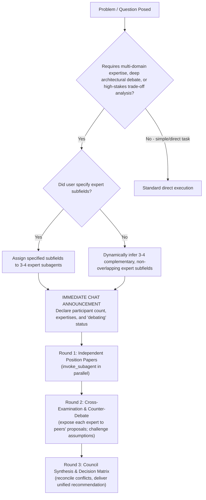

# `experts_council` — Multidisciplinary Expert Debate Council

## Overview

The **Expert Council** convenes an adversarial and collaborative panel of **3 to 4 specialized subagents** to debate, scrutinize, and resolve complex architectural, scientific, statistical, or engineering problems. 

Rather than relying on a single generalist perspective, the council decomposes a question into distinct domain expertises, conducts a structured multi-round debate, and synthesizes an actionable, battle-tested consensus.

---

## When to Use



### Triggering Conditions
- Complex architectural choices with competing trade-offs (e.g. storage vs. compute, model architectures).
- High-stakes statistical or methodological questions (e.g. null distribution validity, filtering thresholds, model selection).
- Scientific hypotheses, experimental interpretations, or cross-domain investigations.
- Explicit user commands: `/experts_council`, "convene council", "seek expert council", "debate with experts", "get expert opinion on...".

---

## Core Operational Protocol

The council operates in **4 strict sequential steps**:

```
Step 1: Determine 3-4 Expert Domains (User-specified or dynamically inferred)
        ↓
Step 2: MANDATORY Immediate Chat Communication (Announce count, domains, debating status)
        ↓
Step 3: Structured Multi-Round Debate (Round 1: Positions → Round 2: Cross-Examination)
        ↓
Step 4: Council Synthesis & Actionable Recommendation
```

---

### Step 1: Expert Subfield Assignment

Determine whether the user explicitly listed the domain expertises for the problem:

1. **If user specified subfields:**
   - Map each requested subfield directly to an expert role (ensure total count is 3 or 4).
   - If the user specified fewer than 3, supplement with the most critical missing perspective (e.g., an Empirical Data/Quality Skeptic) to reach 3.
   - If the user specified more than 4, consolidate overlapping domains to cap the council at 4 focused experts.

2. **If user did NOT specify subfields:**
   - Dynamically analyze the question and select **3 or 4 complementary, non-overlapping, high-rigor domain specializations**.
   - Ensure the roster covers theoretical foundations, practical implementation, and adversarial critique.

#### Canonical Roster Patterns by Domain

| Problem Domain | Expert 1 | Expert 2 | Expert 3 | Expert 4 (Optional) |
|---|---|---|---|---|
| **Neural Data / Statistics** | Mathematical Statistician (null models, FDR, bias) | Domain Neurobiologist (physiological plausibility) | Computational Software Architect (vectorization, memory) | Empirical Data Skeptic (noise, artifacts, edge cases) |
| **Pipeline / Architecture** | Systems & Scalability Architect (IO, RAM, concurrency) | API & Data Contracts Designer (clean abstractions, interfaces) | Reliability & Test Engineer (fail-safes, boundary handling) | Production Performance Specialist (latency, caching) |
| **Model Selection / ML** | Theoretical ML Scientist (loss formulations, inductive bias) | Empirical Benchmarking Specialist (CV schemes, leakage) | Numerical & Optimization Engineer (gradient stability, solvers) | Domain Applied Scientist (real-world interpretability) |

---

### Step 2: MANDATORY Immediate Chat Communication

> [!IMPORTANT]
> **Zero Delay Requirement:** Before or immediately upon launching the subagents, you **MUST** post an explicit notification to the user in the main conversation chat. Never run the debate silently in the background without first sending this announcement.

#### Required Message Template:

```markdown
🏛️ **Expert Council Convened**

Starting **[3 or 4]** specialized subagents to analyze and debate the problem:

1. **Expert 1: [Expertise Domain]** — Focus: [Brief 1-sentence description of role and analytical lens]
2. **Expert 2: [Expertise Domain]** — Focus: [Brief 1-sentence description of role and analytical lens]
3. **Expert 3: [Expertise Domain]** — Focus: [Brief 1-sentence description of role and analytical lens]
4. *(If 4)* **Expert 4: [Expertise Domain]** — Focus: [Brief 1-sentence description of role and analytical lens]

The council subagents are now actively debating to solve the problem.
```

---

### Step 3: Multi-Round Debate Protocol

The debate consists of **two active rounds** followed by **synthesis**:

#### Round 1: Parallel Independent Position Statements
Invoke all 3-4 subagents simultaneously using `invoke_subagent`. Each expert works in parallel without seeing the other experts' initial positions to prevent premature consensus or anchoring bias.

**Subagent Prompt Template (Round 1):**
```text
You are an expert member of the Expert Council on the following problem:
"{problem_statement}"

Your Assigned Expertise Domain: {expert_domain}
Your Analytical Persona: You approach the problem strictly through the lens, rigorous methodologies, and constraints of {expert_domain}.

Please deliver your independent position paper covering:
1. Domain Diagnostic: How this problem appears through your specific domain lens.
2. Concrete Proposal: Your recommended technical or methodological solution.
3. Foundational Assumptions: Core assumptions underpinning your approach.
4. Edge Cases, Failure Modes & Risks: Where this approach could fail, break, or introduce errors.
5. Key Demands on Other Domains: What you require from other disciplines to make this work.

Keep your response precise, evidence-based, and mathematically/architecturally rigorous.
```

#### Round 2: Adversarial Cross-Examination & Counter-Debate
Once all experts return their Round 1 positions, the orchestrator compiles them into an anonymized or attributed dossier and prompts each expert to cross-examine their peers.

**Subagent Prompt Template (Round 2 — Cross-Examination):**
```text
You are Expert: {expert_domain}.
The Expert Council has completed Round 1. Here are the positions presented by your fellow council members:

{all_round_1_positions}

As the specialist in {expert_domain}, conduct a rigorous cross-examination:
1. Direct Critiques: Identify flawed assumptions, unstated trade-offs, or blind spots in the other experts' proposals.
2. Defense & Concessions: Address potential weaknesses they pointed out regarding your approach. Where do you concede or refine your stance?
3. Interdisciplinary Friction: Where do the proposals directly conflict, and why should your domain's priorities take precedence (or how can they be reconciled)?
4. Refined Final Proposal: State your updated, battle-tested recommendation.
```

---

### Step 4: Council Synthesis & Actionable Verdict

Collect the Round 2 cross-examinations and synthesize the final outcome. Deliver the synthesis directly to the user in the following structured format:

```markdown
# 🏛️ Expert Council Verdict & Synthesis

## 1. Executive Summary (BLUF)
[Concise 2-3 paragraph bottom-line verdict answering the user's question, highlighting the winning consensus.]

## 2. Council Roster & Perspectives
- **[Expert 1 Domain]:** [Core stance and key contribution]
- **[Expert 2 Domain]:** [Core stance and key contribution]
- **[Expert 3 Domain]:** [Core stance and key contribution]
- **[Expert 4 Domain (if applicable)]:** [Core stance and key contribution]

## 3. Key Points of Debate & Cross-Examination
- **Point of Contention A:** [How Expert X and Expert Y disagreed, and how it was resolved]
- **Point of Contention B:** [Critical edge case raised by Expert Z that altered the design]

## 4. Synthesized Recommendation & Architecture
[Detailed, step-by-step technical or algorithmic plan combining the strengths of each discipline while mitigating the identified risks.]

## 5. Explicit Trade-offs & Unanimous Cautions
- **Accepted Trade-offs:** [What the council intentionally sacrifices (e.g. memory for speed, conservatism for power)]
- **Hard Boundaries / Do-Not-Cross Rules:** [Explicit failure modes flagged during the debate that must be avoided]
```

---

## Anti-Patterns & Red Flags

| Anti-Pattern | Why It Fails | Mandated Correction |
|---|---|---|
| **Silent Background Spawning** | User is left wondering what is happening while multiple subagents run. | **Mandatory Step 2:** Post the chat announcement with participant count and expertises immediately. |
| **Echo Chamber / Polite Agreement** | Subagents immediately agree without probing failure modes. | Force adversarial cross-examination in Round 2 ("Identify flawed assumptions in other proposals"). |
| **Generalist Persona Drift** | Experts speak in generic AI phrasing rather than domain-specific terminology and methods. | Anchor each subagent to their strict domain lens and require domain-specific diagnostics. |
| **Too Many (>4) or Too Few (<3) Experts** | <3 lacks dynamic debate; >4 leads to context fragmentation and circular arguments. | Strictly enforce 3 or 4 expert subagents. |
| **Unsynthesized Dump of Logs** | Dumping raw transcripts leaves the user with cognitive overload. | Always produce a crisp, structured Step 4 synthesis with an executive BLUF. |
