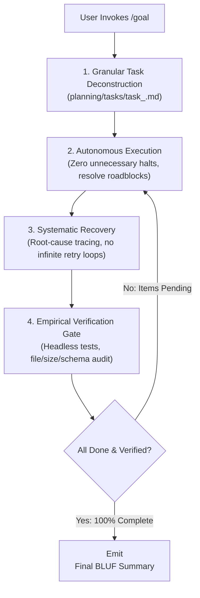

# `goal` — Autonomous Long-Running Goal Execution Protocol

## Overview

The `goal` skill establishes the operational framework for executing long-running, unattended, autonomous tasks (e.g., overnight jobs, major multi-module refactors, end-to-end pipeline executions, exhaustive statistical batch runs).

When `/goal` is invoked, the user delegates full execution authority to the agent with the expectation that the agent will work continuously, resolve challenges independently, thoroughly verify all outcomes, and only terminate when the entire objective is definitively achieved.

---

## The Core Contract

> **NEVER stop until done; NEVER claim done without empirical proof.**

In unattended mode, the user is not present to answer clarifying questions, approve minor variations, or restart a stalled process. The agent acts as an autonomous senior engineer: decisive, self-reliant, mathematically and scientifically rigorous, and committed to total completion.

---

## The 5 Pillars of Goal Execution



### Pillar 1: Self-Reliance & Non-Intervention
- **Do not halt for trivial questions:** When faced with minor ambiguities, evaluate existing codebase conventions, architecture documents (`CONTEXT.md`, `AGENTS.md`), and specs. Choose the standard, clean, well-reasoned solution.
- **Explicit Rationale:** Document any key architectural assumption directly in the task markdown rather than blocking execution to ask the user.
- **Continuous Drive:** Proceed through all pipeline steps (planning $\rightarrow$ implementation $\rightarrow$ testing $\rightarrow$ documentation $\rightarrow$ verification) without requiring intermediate prompts.

### Pillar 2: Granular Planning & Active Task Tracking
- **Task Log Creation:** Immediately initialize or update the task log under `planning/tasks/task_<arm>.md`.
- **Atomic Checklist:** Decompose the overall goal into concrete, sequential tasks with clear binary completion criteria (`[ ]` $\rightarrow$ `[x]`).
- **Milestone Updates:** Mark tasks as complete as progress occurs so progress survives model turn boundaries and task transitions.

### Pillar 3: Systematic Recovery & Loop Defense
- **Diagnosis over Despair:** If a command, script, or unit test fails, do not halt. Immediately apply `systematic-debugging`:
  1. Inspect stderr, logs, and stack traces thoroughly.
  2. Identify the root cause (environment, pathing, parameter mismatch, mathematical bug).
  3. Formulate a minimal, surgically targeted fix.
  4. Test and verify the fix.
- **Anti-Thrashing Rule:** Never blindly repeat the identical failing command without a structural or code fix. If two attempts fail, re-evaluate assumptions and pivot cleanly.

### Pillar 4: Empirical Verification Gates
- **Adhere to `verification-before-completion`:** Assumptions are never substitutes for evidence.
- **Code & Tests:** Execute headless test commands (e.g. `pytest`, conda-specific runs) and inspect actual output.
- **Data & Artifacts:** Confirm that output files are non-empty, array dimensions match specs, and schemas conform to expectations.
- **Repository Cleanliness:** Run `git status` to ensure zero stray arrays, temporary caches, or unapproved files remain untracked.

### Pillar 5: Termination Token Protocol
Autonomous harness runners scan agent output for explicit completion tokens:

- **Goal Accomplished:** When all checklist items are fulfilled, all tests pass, repository state is verified, and documentation is updated, the agent MUST include:
  ```html
  <!-- GOAL_COMPLETE -->
  ```
- **Explicit Cancellation / Impossible Blocker:** Only if the user explicitly requested cancellation or an external blocker cannot be resolved (e.g., missing hardware credentials, inaccessible offline server):
  ```html
  <!-- GOAL_CANCELLED -->
  ```
- **CRITICAL WARNING:** NEVER emit `<!-- GOAL_COMPLETE -->` while tasks, tests, or validation gates remain unexecuted. Emitting this token prematurely aborts the autonomous runner before work is done.

---

## Standard Autonomous Execution Checklist

Any model running in goal mode should execute this standard checklist:

1. [ ] **Intent Declaration:** Classify intent and state pre-flight tag (`[Intent: ... | Skill Stack: ... | Env: ...]`).
2. [ ] **Task Decomposition:** Create or update `planning/tasks/task_<arm>.md`.
3. [ ] **Autonomous Execution:** Execute code modifications, test creation, or analytical pipelines.
4. [ ] **Headless Verification:** Run automated tests and pipeline smoke checks to confirm exit code 0.
5. [ ] **Documentation Sync:** Update relevant `CONTEXT.md` files, specs, or catalogues.
6. [ ] **Repository Cleanliness:** Check `git status` for untracked artifacts or unwanted temporary files.
7. [ ] **Final Signal:** Provide a BLUF summary of results and append `<!-- GOAL_COMPLETE -->`.
