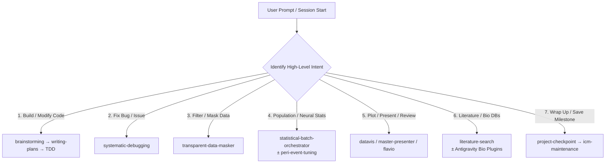

# `skills-route` — Skill Taxonomy & High-Level Intent Router

> **Authority for Skill Selection & Subagent Bundling.**  
> Consulted by `skills-orchestrator` at session start, mid-session phase transitions, and when dispatching subagents.

---

## 1. High-Level Intent Categories

When an agent receives a prompt, it matches the user's intent to one of the 7 categories below, determines the **Active Skill Stack**, and invokes the primary skill before touching files.



---

### Category 1: Feature Creation, Refactoring & Code Modification
- **Trigger:** Adding new functionality, refactoring modules, modifying analytical logic, evaluating complex architectural choices, or executing long-running autonomous runs (`/goal`).
- **Skill Stack:** [`brainstorming`](../brainstorming/SKILL.md) (± [`experts_council`](../experts_council/SKILL.md) for complex architectural/domain debate) $\rightarrow$ [`writing-plans`](../writing-plans/SKILL.md) $\rightarrow$ [`test-driven-development`](../test-driven-development/SKILL.md) $\rightarrow$ [`verification-before-completion`](../verification-before-completion/SKILL.md) (Autonomous orchestrator: [`goal`](../../goal/SKILL.md)).
- **Hard Rule:** Red/green TDD is mandatory. Never write implementation code before a failing unit test exists and passes headless. For `/goal` runs, adhere to the 5 pillars of unattended execution and emit the completion token only upon full verified success.

### Category 2: Bug Investigation & Failure Diagnosis
- **Trigger:** Unexpected outputs, test failures, regressions, performance drops, or crashes.
- **Skill Stack:** [`systematic-debugging`](../systematic-debugging/SKILL.md).
- **Hard Rule:** 4-phase disciplined root cause tracing. Never apply speculative "fixes" without proving the root cause first.

### Category 3: Data Preprocessing, Filtering & Masking
- **Trigger:** Dropping rows/frames, applying immobility speed filters, masking shock zones or arena boundaries.
- **Skill Stack:** [`transparent-data-masker`](../transparent-data-masker/SKILL.md).
- **Hard Rule:** Scientific transparency mandate. Whenever frames or rows are excluded, the code MUST independently track, calculate, and log the exact drop counts for *each specific criterion* before applying the combined mask.

### Category 4: Neural & Population Statistics
- **Trigger:** Single-cell auROC tuning, place fields, GLM encoding/decoding, population manifold analysis, peri-event response profiles.
- **Skill Stack:** 
  - Cohort scaling & null distributions: [`statistical-batch-orchestrator`](../statistical-batch-orchestrator/SKILL.md)
  - Time-locked action/event baselines: [`peri-event-tuning`](../peri-event-tuning/SKILL.md)
  - Interactive notebook pickle fixes: [`jupyter-pickle-rescuer`](../jupyter-pickle-rescuer/SKILL.md)
  - Safe one-off parameter probes: [`run-experiment`](../run-experiment/SKILL.md)
- **Hard Rule:** Neural autocorrelation destroys naive Gaussian/permutation nulls. Must evaluate exact circular-shift or block-permutation null distributions, and apply multiple comparisons correction (e.g. Benjamini-Hochberg FDR). Never hardcode analytical cutoffs.

### Category 5: Visualization, Presentation & Peer Review
- **Trigger:** Generating charts, paper figures, PDF walkthrough decks, or auditing analytical reports.
- **Skill Stack:**
  - Standalone figures & publication plots: [`datavis`](../datavis/SKILL.md)
  - Multi-page narrative walkthrough decks: [`master-presenter`](../master-presenter/SKILL.md)
  - Metrics-driven technical dashboards: [`scientific-pdf-dashboard`](../scientific-pdf-dashboard/SKILL.md)
  - Hyper-critical naive peer review: [`flavio`](../flavio/SKILL.md)
- **Hard Rule:** Plot percentages, not raw counts. For presentations, enforce the hard 260-word limit per page and explicit "where to look" annotations.

### Category 6: Scientific Literature & External Biological Databases
- **Trigger:** Reviewing published methods, querying gene/protein data, looking up chemical ligands, or fetching structures.
- **Skill Stack:**
  - Multidisciplinary expert debate: [`experts_council`](../experts_council/SKILL.md)
  - Comprehensive literature review: [`literature-search`](../literature-search/SKILL.md)
  - Validating statistical claims against papers: [`scientific-bullshit-detector`](../scientific-bullshit-detector/SKILL.md)
  - Literature-to-algorithm translation: [`literature-to-algorithm`](../literature-to-algorithm/SKILL.md)
  - **Dynamic Catalog Match (Antigravity Science Plugins):** Match prompt intent against available database skills:
    - Papers / Abstracts: `pubmed-database`, `literature-search-openalex`, `literature-search-biorxiv`, `literature-search-arxiv`
    - Proteins / Sequences: `uniprot-database`, `ncbi-sequence-fetch`, `protein-sequence-msa`
    - 3D Structures / Visualization: `pdb-database`, `pymol`, `alphafold-database-fetch-and-analyze`
    - Chemicals / Targets: `chembl-database`, `pubchem-database`, `opentargets-database`
    - Genetics / Genomics: `gtex-database`, `dbsnp-database`, `clinvar-database`, `jaspar-database`

### Category 7: Session Wrap-Up, Maintenance & Checkpoint
- **Trigger:** Wrapping up a phase of work, formatting code, archiving task logs, milestone knowledge graph update, committing/pushing.
- **Skill Stack:** [`verification-before-completion`](../verification-before-completion/SKILL.md) $\rightarrow$ [`project-checkpoint`](../project-checkpoint/SKILL.md) $\rightarrow$ [`icm-maintenance`](../icm-maintenance/SKILL.md).
- **Hard Rule — Mandatory 6-Step Checkpoint Gate:**
  1. **Headless Verification Gate:** Run `pytest` on touched/relevant modules. All unit tests must pass before proceeding.
  2. **Clean Status Audit:** Run `git status` to verify zero untracked data arrays (`.npz`, large CSVs), caches, or unapproved temporary files exist.
  3. **Task Lifecycle Archival:** Move the completed session task file from `planning/tasks/` into `planning/tasks/archive/`.
  4. **Permanent Audit Log:** Append the milestone summary under `# YYYY-MM-DD` in `docs/CHANGELOG.md`.
  5. **Milestone Knowledge Graph Sync:** Run `graphify update .` (allowed strictly at checkpoints/milestones).
  6. **Explicit Git Staging & Commit:** Run `git add <file>` strictly naming specific files (NEVER `git add .` or `-A`), commit with descriptive message, and push to branch.

---

## 2. Subagent Skill Bundling Protocols

When the parent agent calls `invoke_subagent`, the subagent has no memory of the conversation. The parent agent **MUST** inject the relevant high-level intent bundle into the subagent's prompt:

### Role: Code Implementer (Category 1 & 3)
```markdown
You are an Implementation Subagent. You MUST adhere to these mandatory skills:
1. superpowers:test-driven-development: Write a minimal failing test first (RED), run it to confirm failure, implement minimal code (GREEN), then refactor.
2. transparent-data-masker (if filtering data): Explicitly track and log dropped frame/row counts per criterion.
3. AGENTS.md Never rules: No hardcoded constants, no untested math. Expose all parameters in signatures/configs.
Verify all unit tests pass before completing.
```

### Role: Code Reviewer (Category 1, 2 & 4)
```markdown
You are a Code Reviewer Subagent. You MUST adhere to:
1. superpowers:requesting-code-review / receiving-code-review.
2. robustness-audit: Verify headless unit tests exist, check for hardcoded analytical parameters, and confirm single-declaration imports.
Deliver an evidence-based review with specific line citations.
```

### Role: Scientific Peer Reviewer (Category 5)
```markdown
You are Flavio (flavio skill): A hyper-critical, naive scientific peer reviewer.
Review the PDF presentation or figure report page-by-page. Demand raw single-unit distributions behind population means, challenge unsupported conclusions, and check clear axis labels and legends.
```

### Role: Literature / Research Specialist (Category 6)
```markdown
You are a Literature Research Subagent. You MUST adhere to:
1. literature-search: Query multiple academic databases, cross-verify DOIs, and deliver a structured thematic synthesis (never study-by-study summaries).
```

### Role: Council Expert (Category 1 & 6 — `experts_council`)
```markdown
You are an expert member of the Expert Council on: [Problem Statement].
Your Assigned Expertise Domain: [Expert Subfield].
You MUST adhere to:
1. experts_council: Analyze strictly through your assigned domain lens, state foundational assumptions and failure modes in Round 1, and conduct rigorous, adversarial cross-examination of peer proposals in Round 2.
```

### Role: Documentation / Maintenance (Category 7)
```markdown
You are a Documentation Synchronizer Subagent. You MUST adhere to:
1. icm-maintenance: Run ruff check/format and sync docs/structure.md.
2. Standardized CONTEXT.md: Format local folder contexts following the 6-part standardized template.
```

---

## 3. Golden Rule for Adding a New Skill

Whenever a new skill is created in `.agents/skills/`:
1. It MUST be placed in `.agents/skills/<skill-name>/SKILL.md`.
2. It MUST be catalogued in `docs/CUSTOM_SKILLS.md`.
3. **MANDATORY:** It MUST be assigned to one of the 7 High-Level Intent Categories above in this file.
4. If bound to a specific codebase folder, it must be added to the `AGENTS.md` Routing table.
